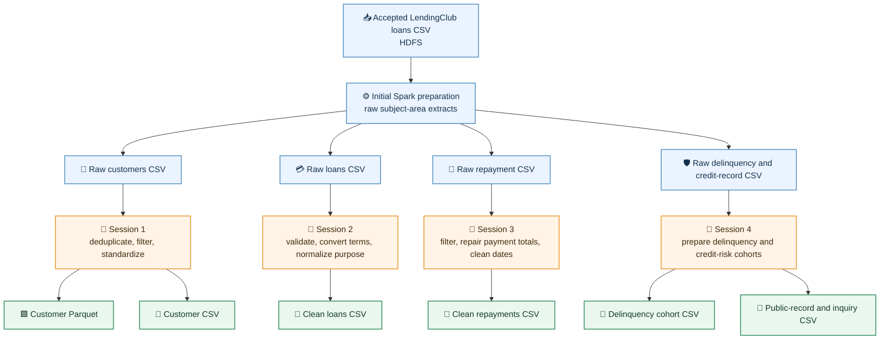
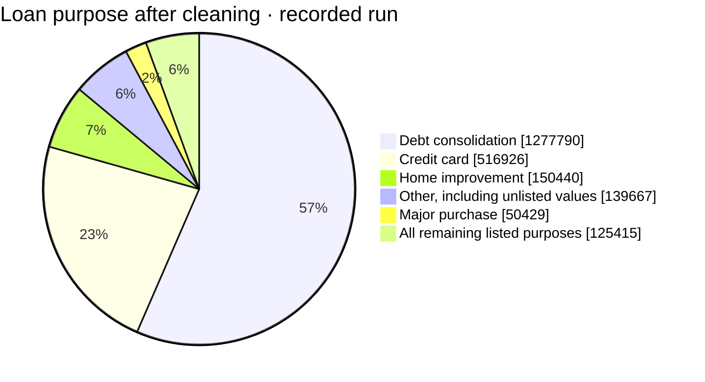

<h1 align="center">🧹 LendingClub Data Cleaning</h1>

<p align="center">
  <strong>Four PySpark sessions · Four subject areas · Six cleaned outputs</strong><br />
  A visual guide to the customer, loan, repayment, and borrower-risk cleaning workflow
</p>

<p align="center">
  
  
  
  
</p>

## 🧭 At a glance

These notebooks continue the LendingClub project by cleaning the four raw subject-area extracts produced by the initial Spark workflow. Each session starts a Spark application on YARN, reads its HDFS input, applies domain-specific cleaning rules, and writes cleaned data back to HDFS.

## 🗺️ End-to-end flow



## 🧹 Session walkthrough

### 1 · 👤 Customer data — `Data Cleaning Session 1.ipynb`

**Input:** `/user/itv026162/lendingclub/project/raw/customers_data_csv`

**Cleaning path:**

```text
Read with schema → Rename fields → Add ingest_date → Remove exact duplicates
→ Drop missing annual income → Clean employment length → Fill missing length with 6
→ Normalize address state → Write Parquet and CSV
```

- Renames fields such as `annual_inc` → `annual_income`, `addr_state` → `address_state`, and `zip_code` → `address_zipcode`.
- Adds `ingest_date` using the current timestamp.
- Removes exact duplicate rows, then filters out records with null annual income.
- Removes non-digits from employment-length values and casts the result to an integer.
- Fills missing employment length with the floored average: approximately **6.02**, rounded down to **6**.
- Changes address-state values longer than two characters to `NA`; keeps other values and preserves nulls for later review.

**Recorded checks:** 2,260,702 rows before `distinct()`, 2,260,639 after; six null-income rows filtered; 146,903 employment-length nulls filled with `6`; 254 address-state values longer than two characters identified.

**Outputs:**

- `/user/itv026162/lendingclub/project/cleaned/customers_parquet`
- `/user/itv026162/lendingclub/project/cleaned/customers_csv`

### 2 · 💳 Loan data — `Data Cleaning 2.ipynb`

**Input:** `/user/itv026162/lendingclub/project/raw/loans_data_csv`

**Cleaning path:**

```text
Read with header and schema → Add ingest_date → Drop rows missing required fields
→ Convert loan term from months to years → Normalize loan purpose → Write CSV
```

- Drops rows that are missing any of eight selected loan fields, including amount, term, rate, installment, issue date, status, and purpose.
- Converts terms such as `36 months` to **3 years** and renames the field to `loan_term_years`.
- Keeps the listed loan-purpose values. The code maps every purpose outside its lookup list to `other`.

**Recorded checks:** 2,260,701 input rows; 33 rows had null `loan_amount`; 34 rows were removed by the complete required-field null check.

**Output:** `/user/itv026162/lendingclub/project/cleaned/loan_data_csv`

#### 🎯 Loan-purpose distribution

The chart shows the leading categories after the notebook's purpose normalization. The `other` category also includes unlisted values such as `stocks` and free-text entries.



### 3 · 💸 Repayment data — `Data Cleaning 3.ipynb`

**Input:** `/user/itv026162/lendingclub/project/raw/loans_repayments_data_csv`

**Cleaning path:**

```text
Read with header and schema → Add ingest_date → Drop incomplete payment records
→ Recalculate inconsistent zero totals → Remove remaining zero totals
→ Convert 0.0 date placeholders to null → Write CSV
```

- Removes rows missing any of five key payment fields: principal, interest, late fees, total payment, or last-payment amount.
- When total payment is `0.0` but principal received is non-zero, recalculates total payment as principal + interest + late fees.
- Filters out any records whose total payment remains zero after that correction.
- Converts `0.0` placeholders in last- and next-payment dates to null.

**Recorded checks:** 2,260,701 input rows; 69 null principal values; 203 rows removed by the five-field null check. Before correction, 995 rows had a zero total payment, including 46 with non-zero principal. After the payment filter, the notebook found 48 last-payment and 24 next-payment date placeholders.

**Output:** `/user/itv026162/lendingclub/project/cleaned/loan_repay_data_csv`

### 4 · 🛡️ Delinquency and credit-risk data — `Data Cleaning 4.ipynb`

**Input:** `/user/itv026162/lendingclub/project/raw/loan_defaulters_data_csv`

**Cleaning path:**

```text
Read with header and schema → Cast delinq_2yrs to integer → Fill its nulls with 0
→ Split into delinquency and public-record/inquiry cohorts → Write two CSVs
```

- Casts `delinq_2yrs` to an integer and fills null values in that field with `0`.
- Creates a **delinquency cohort** when `delinq_2yrs > 0` or `mths_since_last_delinq > 0`.
- Creates a **public-record/inquiry cohort** when `pub_rec`, `pub_rec_bankruptcies`, or `inq_last_6mths` is greater than zero.

**Recorded checks:** the null check for `delinq_2yrs` returned **0** after filling; the delinquency cohort contained **1,106,163** rows and the public-record/inquiry cohort contained **1,070,125** member IDs.

**Outputs:**

- `/user/itv026162/lendingclub/project/cleaned/loan_defaulters_deling_csv`
- `/user/itv026162/lendingclub/project/cleaned/loan_defaulters_records_enq_csv`

> These are delinquency and credit-risk indicator cohorts. The notebook does not classify every included borrower as a confirmed loan defaulter, and the two cohorts may overlap.

## 🧰 Running the sessions

The notebooks create a Spark session with YARN and Hive support and call `spark.stop()` at the end. Run each notebook from top to bottom against its required raw HDFS input. If a notebook has already reached `spark.stop()`, restart the kernel and rerun its setup before running more Spark actions.

All outputs use overwrite mode, so rerunning a session replaces that session's output path.

<details>
<summary>🔎 Implementation notes to check before relying on the counts</summary>

- **Customer CSV header:** Session 1 supplies a schema but does not set `header=true`. The upstream CSV is headered, and Spark CSV defaults to `header=false`; the header line may therefore be read as a record. Add `.option("header", "true")` and rerun before treating Session 1's counts as final. [Spark CSV options](https://spark.apache.org/docs/3.5.8/sql-data-sources-csv.html)
- **Address-state threshold:** Session 1's code uses `length(address_state) > 2`, while a markdown note says “longer than three.” The flow above describes the code's two-character rule.
- **Customer schema labels:** Session 1's supplied schema spells fields `empl_length` and `verfication_status_joint`; the upstream headers are `emp_length` and `verification_status_joint`.
- **Loan-purpose note vs. code:** Session 2's comment says unusual purposes should remain separate, but its transformation assigns every value outside `loan_purpose_lookup` to `other`.
- **Employment-length interpretation:** Removing non-digits turns `< 1 year` into `1` and `10+ years` into `10`. Confirm this interpretation is suitable for the intended analysis.
- **Default label:** Session 4 selects risk indicators; it does not create a definitive default/not-default label.

</details>
