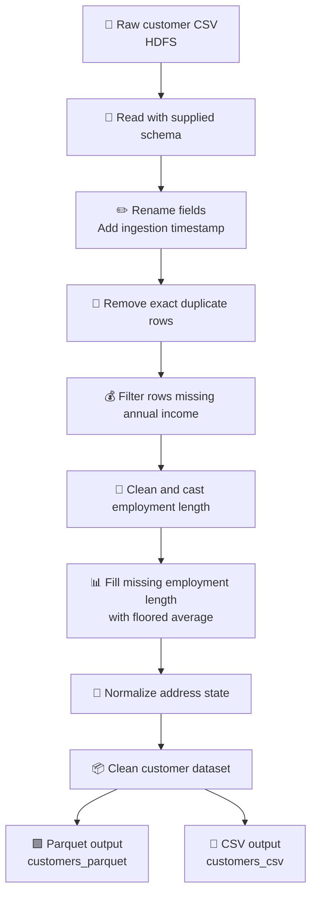

<h1 align="center">🧹 Customer Data Cleaning</h1>

  <strong>LendingClub Data Engineering Project · Session 1</strong> 
  Preparing customer data for downstream analysis with PySpark

  
  
  

## 🌟 Overview

This notebook cleans the customer extract created from the LendingClub accepted-loan data. It standardizes field names, adds an ingestion timestamp, removes duplicate and incomplete records, prepares employment length and address-state fields, then saves the cleaned data in Parquet and CSV formats.

## 🔄 Data flow

## 🧽 Cleaning steps

1. **Read the raw customer extract** from HDFS using an explicit schema. Income and credit-limit fields are read as numeric values.
2. **Rename fields** for readability, including `annual_inc` → `annual_income`, `addr_state` → `address_state`, `zip_code` → `address_zipcode`, and `tot_hi_cred_lim` → `total_high_credit_limit`.
3. **Add `ingest_date`** with the current timestamp.
4. **Remove exact duplicate rows** using `distinct()`.
5. **Remove rows with missing annual income.** The recorded run found six such rows after deduplication.
6. **Clean `empl_length`** by stripping non-digit characters and casting the result to an integer.
7. **Fill missing employment lengths** with the floored average. The recorded average was about 6.02 years, so null values were filled with **6**.
8. **Standardize `address_state`.** Values longer than two characters are changed to `NA`; other values are retained, and null values remain null for later review.

## 📈 Recorded data checks

The notebook’s saved run shows:

- **2,260,702** rows before deduplication and **2,260,639** after `distinct()` (a difference of 63 rows).
- **6** rows with null `annual_income` were filtered out.
- **146,903** null employment-length values were filled with `6`; the final null check returned **0**.
- **254** non-null address-state values longer than two characters were identified for replacement with `NA`.

These are the notebook’s recorded counts. See the input note below before treating them as final, because the CSV reader currently does not enable header handling.

## 📤 Output data

Both outputs are overwritten when the notebook is rerun:

- **Parquet** — `/user/itv026162/lendingclub/project/cleaned/customers_parquet`  
  Preferred for compact storage and analytical processing.
- **CSV** — `/user/itv026162/lendingclub/project/cleaned/customers_csv`  
  Convenient for inspection and exchange with other tools.

## ▶️ Run the notebook

Open `Data Cleaning Session 1.ipynb` in a PySpark environment with access to HDFS, YARN, and Hive support. Confirm the raw customer CSV exists at `/user/itv026162/lendingclub/project/raw/customers_data_csv`, then run the cells from top to bottom. Keep the Spark session active until both output writes finish; call `spark.stop()` only at the end.

## 📝 Implementation notes

- The upstream CSV includes a header, but the current read step supplies a schema without setting `header=true`. Spark CSV reads default to `header=false`, so the header row can be treated as data and affect the recorded counts. Consider adding `.option("header", "true")` before relying on those counts. [Spark CSV options](https://spark.apache.org/docs/3.5.8/sql-data-sources-csv.html)
- The address-state code uses `length(address_state) > 2`; one notebook comment says “longer than three.” Align the comment with the two-character rule used in the transformation.
- The supplied schema spells two fields `empl_length` and `verfication_status_joint`; the upstream headers are `emp_length` and `verification_status_joint`. Consider aligning those names for clarity.
- Removing non-digits maps values such as `< 1 year` to `1` and `10+ years` to `10`. Confirm that this interpretation matches the analysis requirements.
