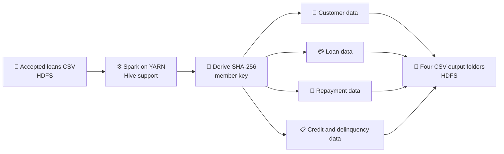

# 📊 Data Engineering Backend Data

<p align="center">
  
  
  
</p>

An Apache Spark data engineering project that prepares LendingClub loan data for downstream analysis. The notebook reads the accepted-loan dataset from HDFS, derives a hashed member key from borrower profile fields, and writes four subject-area CSV extracts back to HDFS.

## ✨ Overview

The source file contains loan, borrower, repayment, and credit-history fields in one wide CSV. The notebook creates a Spark session configured for YARN and Hive, loads the source data, registers it as a temporary view, and uses Spark SQL to select fields for each output dataset.

It also explores whether a usable member identifier can be derived. The notebook builds `name_sha2` with SHA-256 over nine borrower attributes: employment title and length, home ownership, annual income, ZIP code, state, grade, sub-grade, and verification status. This is an assumed surrogate key, not an official LendingClub member ID.

## 🔄 Data flow



## 📦 Output datasets

All outputs are written beneath `/user/itv026162/lendingclub/project/raw/`:

- 👤 `customers_data_csv` — derived member ID, employment, income, location, home ownership, credit grade, and application details.
- 💳 `loans_data_csv` — loan ID, member ID, requested and funded amounts, term, interest rate, instalment, issue date, status, purpose, and title.
- 💸 `loans_repayments_data_csv` — loan ID, principal and interest received, late fees, payment totals, and payment dates.
- 📋 `loan_defaulters_data_csv` — member ID and delinquency, public-record, inquiry, and late-fee indicators.

Each output is written with `repartition(1)`, so Spark produces one CSV data part per output directory. Spark may also add metadata files such as `_SUCCESS`.

## 📂 Source data

The notebook expects the input file at:

```text
/user/itv026162/lendingclub/accepted_2007_to_2018Q4.csv
```

The expected source is the LendingClub `accepted_2007_to_2018Q4.csv` dataset.

## 🚀 Run the notebook

Open `Lending_club_project.ipynb` in a PySpark environment with access to HDFS, YARN, and Hive support. Ensure the source CSV is available at the HDFS path above, then run the notebook cells from top to bottom. The output directories are overwritten when the notebook is run again.

## 🔎 Identity key and data checks

In its recorded run, the notebook reports **2,260,701 rows** and **2,257,384 distinct hashes**. Repeated hashes can represent shared profile values, not necessarily the same person. Rows whose nine hash inputs are all null produce the SHA-256 hash of an empty string; the notebook identifies these rows but does not remove them from the output datasets.

## ⚠️ Assumptions and limitations

- `name_sha2` is derived from borrower profile attributes because the notebook treats the source member ID as unavailable. Borrowers with identical values in those fields receive the same hash, so it is not a guaranteed unique or authoritative customer identifier.
- `loan_defaulters_data_csv` is a name for the selected risk and delinquency fields. The notebook does not filter rows to confirmed defaulters or default loan statuses, so this extract contains those indicators for the source records generally.
- The notebook uses schema inference and does not define explicit validation, cleaning, or null-handling rules for the other source fields.
